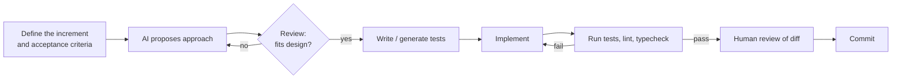

# AI-Assisted Development Workflow

This project was built with AI tools as an active collaborator. This document explains how they were used, where human judgment stayed in control, and how AI output was verified.

## Tools

| Tool | Used for |
|---|---|
| Claude (chat) | Reading the brief, requirements analysis, scoping, architecture and decision records |
| Claude Code (agentic, in the repository) | Implementation, tests, refactoring, documentation updates |

## Principles

1. **Think before generating.** Requirements and architecture were written and reviewed before any application code. AI was used to analyse the brief, lay out options with their trade-offs and document the decisions, not to start coding.
2. **The human owns decisions.** AI proposed options with trade-offs; every stack, scope and design choice was made explicitly and recorded in [decisions.md](decisions.md).
3. **Small, reviewable steps.** Work was broken into increments that each end in a passing test suite and a focused commit, so the history shows how the solution evolved.
4. **Tests are the contract.** Behaviour is pinned down by tests. AI-generated code is accepted only when tests pass and the code is understood.
5. **Verify, don't trust.** Facts that change over time (hosting free tiers, platform limits) were checked against current sources rather than taken from model memory.
6. **Persistent instructions.** [`CLAUDE.md`](../CLAUDE.md) gives the coding agent the project's conventions, so every session follows the same standards.

## Workflow per increment

## Where AI output was corrected or overridden

Recorded as they happen, so the review shows judgment rather than just generation.

| Area | AI suggestion | What was decided, and why |
|---|---|---|
| Scope | Excel import/export initially proposed as out of scope | Brought into scope: HR's data lives in spreadsheets today, so import/export is the realistic migration path. Narrowed to .xlsx, all-or-nothing, never deleting. |
| Import limit | 10,000 rows / 5 MB per file | Reduced to 1,000 rows / 1 MB. Import is for routine batches; the seed script loads the full organization. The smaller cap keeps a whole file to one upsert on a 0.1 vCPU instance. |
| Salary storage | Documentation said salaries are "never floating point", which reads as "whole numbers only" | Kept exact `numeric(12,2)` storage and made two-decimal support explicit in the requirements, ADR-6, `CLAUDE.md` and validation tests. |
| Commit structure | Generated scaffold imported the employee entity and module before they existed, so that commit could not build on its own | Each module is now wired in by the commit that creates it; every commit builds and passes its tests independently. |
| Performance claim | Local response times of 300–640 ms appeared to miss the 300 ms target | Measured database execution separately (0.4–23 ms per query) and identified network latency as the cause; both figures are recorded rather than a single misleading number. |
| Error messages | Library defaults such as "must be a valid ISO 8601 date string" | Rewritten in HR's terms and mapped to spreadsheet column names, found during manual verification of the import. |
| Database region | Deploy the API in Render's Singapore region as the "closest" to a Sydney database | Measured instead of assumed: ~260 ms of every request was cross-region network. The database was moved to Singapore, cutting responses from 298–369 ms to 126–185 ms. |
| Integration test database | Run the integration tests in a local Docker container | No Docker dependency: the suite accepts any PostgreSQL database named `*_test`. CI provides its own, and locally a separate `salary_test` database in the existing Supabase project was used. |
| Visual design | A "Clean SaaS" indigo theme with an untinted slate dark mode | Replaced after comparing palettes side by side: a teal brand used identically in both modes, teal-tinted dark surfaces and Poppins type, following an HRMS reference design (ADR-11). |
| Browser history | Directory changes replaced the history entry, so Back skipped every filter and page change | Paging, filters and sort are now history steps; only typing in search replaces the current entry (ADR-12). |
| Directory paging | The grid's next page snapped back to page 1 | Found in review. The sort model was rebuilt on every render and the grid treated it as a new sort. Models are memoised, and a regression test waits for the grid's delayed adjustment that the first tests missed. |
| Date input | The browser's native date field | Its calendar cannot follow the theme or dark mode. Replaced by MUI's themed date picker, loaded only when the form opens. |
| Import messages | An empty cell reported the first failing rule, e.g. "must be shorter than 120 characters" | Found by end-to-end testing. Empty cells now read "<Column> is required", with a test for every column. |
| Test environment | Run browser tests against the local dev server already running | Data-changing tests run only against a throwaway local PostgreSQL, with the deployed API blocked at the network level, so test data cannot reach production. |

## Prompt log

Key prompts are kept in [`prompts/`](prompts/), one file per phase. Each entry records the intent, the prompt, the outcome, and the human decision that set the direction.

| Phase | File |
|---|---|
| 01 — Planning and requirements | [prompts/01-planning.md](prompts/01-planning.md) |
| 02 — Backend | [prompts/02-backend.md](prompts/02-backend.md) |
| 03 — Frontend | [prompts/03-frontend.md](prompts/03-frontend.md) |
