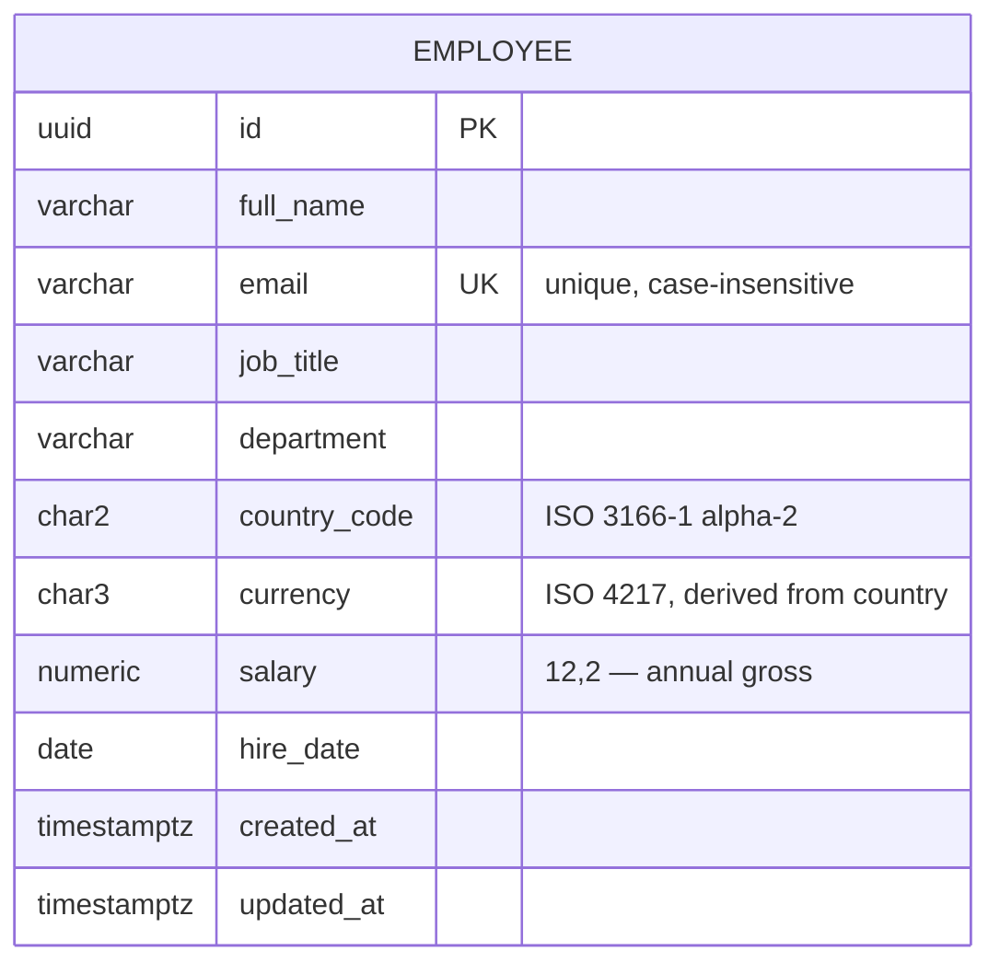
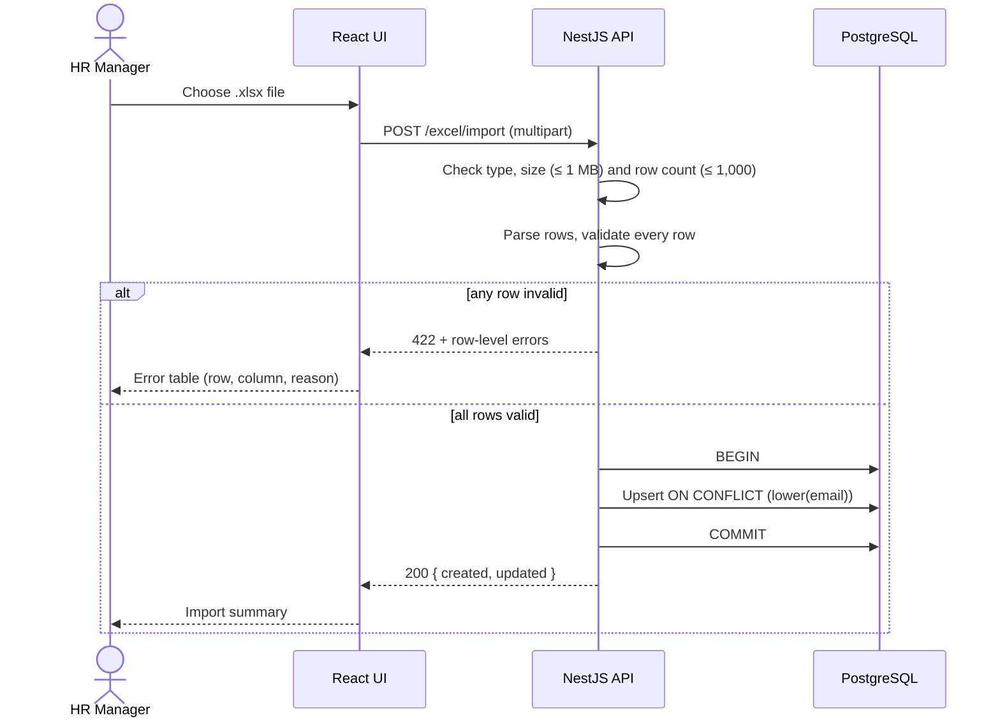

# Architecture

This document describes how the Salary Management system is structured and why. Decisions referenced as **ADR-n** are recorded in [decisions.md](decisions.md).

## System overview


Three deployable parts, each on a managed free tier:

| Part | Responsibility | Hosting |
|---|---|---|
| Frontend | Directory, employee forms, insights, import/export UI | Vercel |
| Backend | Validation, business rules, aggregation queries, Excel parsing/generation | Render |
| Database | Source of truth for employee and salary data | Supabase (PostgreSQL) |

## Repository layout

```
salary-management/
├── backend/            NestJS API
│   ├── src/
│   │   ├── employees/      CRUD, directory queries
│   │   ├── insights/       salary aggregations
│   │   ├── excel/          import (parse, validate, upsert) and export
│   │   ├── health/         liveness + database check
│   │   ├── common/         country/currency reference data, shared DTOs, pipes
│   │   └── database/       TypeORM config, migrations, seed script
│   └── test/
├── frontend/           React SPA
│   └── src/
│       ├── api/            typed API client
│       ├── features/       employees, insights, import-export
│       └── components/     shared UI
└── docs/               requirements, architecture, decisions, AI workflow
```

## Backend design

Each feature is a NestJS module with the same layering:

```
Controller  →  Service  →  Repository (TypeORM)
 HTTP, DTOs     business      persistence,
 validation     rules         SQL aggregates
```

- **Controllers** are thin: they map HTTP to DTOs and delegate. Validation uses `class-validator` DTOs with a global `ValidationPipe` (whitelisting on, unknown fields rejected).
- **Services** hold business rules (currency derivation, import validation, upsert decisions) and are unit tested with mocked repositories.
- **Repositories** own all query construction. Aggregations run in SQL, not in application memory (ADR-5).

### Data model



- A single table keeps the model honest for the scope: current salary only (salary history is out of scope — see requirements).
- `currency` is derived from `country_code` by the service, never accepted from the client, so the two cannot disagree.
- `salary` is `numeric(12,2)`: annual gross with up to 2 decimal places, stored exactly. It is mapped through a TypeORM transformer because Postgres returns `numeric` as a string. Binary floating point is never used to store or aggregate money (ADR-6).

**Indexes:** `country_code`, `department`, `(country_code, job_title)`, and a unique index on `lower(email)`.

### API

| Method | Path | Purpose |
|---|---|---|
| `GET` | `/employees` | Directory: `page`, `pageSize`, `search`, `country`, `department`, `jobTitle`, `sortBy`, `sortOrder` |
| `GET` | `/employees/:id` | Employee detail |
| `POST` | `/employees` | Create |
| `PATCH` | `/employees/:id` | Update |
| `DELETE` | `/employees/:id` | Delete |
| `GET` | `/employees/filter-options` | Distinct countries, departments, job titles for filter dropdowns |
| `GET` | `/insights/overview` | Total headcount; headcount by country and by department |
| `GET` | `/insights/countries` | Per country: headcount, min, max, average, median salary |
| `GET` | `/insights/countries/:code/job-titles` | Per job title in a country: headcount, average, min, max |
| `GET` | `/excel/template` | Blank import template (.xlsx) |
| `POST` | `/excel/import` | Upload .xlsx; all-or-nothing upsert by email |
| `GET` | `/excel/export` | Directory export (.xlsx), same filters as `/employees` |
| `GET` | `/health` | Liveness and database connectivity |

`GET /employees` returns `{ items, total, page, pageSize }`. `pageSize` defaults to 25 (maximum 100), sorting defaults to `fullName` ascending, and `sortBy` accepts only `fullName`, `salary` or `hireDate`. Search matches name or email case-insensitively; `%` and `_` in the search text match literally.

Errors follow one shape: `{ statusCode, message, errors? }`. Import validation failures return `422` with row-level `errors: [{ row, column, message }]`.

### Excel import flow



Validation runs over the whole file before any write, and the write happens in one transaction, so a file is either fully applied or not at all (ADR-7). All rows are written with a single multi-row upsert statement, so even a full 1,000-row file costs one database round trip. The 1,000-row limit keeps imports to a few seconds on a small instance; the initial 10,000 employees are loaded by the seed script, not by import.

## Frontend design

- **Feature folders** (`employees`, `insights`, `import-export`) each own their pages, components and hooks.
- **Server state** via TanStack Query: caching, loading and error states, and cache invalidation after create/update/delete/import.
- **Directory** uses MUI DataGrid in server mode: paging, sorting and filtering are sent to the API, so the browser never holds 10,000 rows.
- **Typed API client** in `src/api` is the only place that knows URLs.

### Responsive layout

The UI is built mobile-first with MUI breakpoints, and verified at three reference widths: **360 px** (phone), **768 px** (tablet) and **1280 px** (desktop).

| Area | Phone (`xs`) | Tablet (`sm`–`md`) | Desktop (`lg`+) |
|---|---|---|---|
| Navigation | App bar with a slide-out drawer | Slide-out drawer | Permanent side navigation |
| Employee directory | Card list (name, title, country, salary) with infinite paging | Data grid with essential columns only | Full data grid |
| Filters | Collapsible filter panel | Inline filter row | Inline filter row |
| Employee form | Single column, full-screen dialog | Two columns | Two columns in a dialog |
| Insights | Stacked summary cards; tables scroll horizontally | Two-column grid | Multi-column grid |
| Import errors | Scrollable error list | Table | Table |

Touch targets are at least 44 × 44 px, and nothing depends on hover to be discoverable.

## Performance considerations

| Concern | Approach |
|---|---|
| Listing 10,000 employees | Server-side pagination (default 25, max 100 per page); count and page fetched in one request |
| Filtering and sorting | Indexed columns; sort fields whitelisted to prevent arbitrary SQL |
| Search | `ILIKE` on name and email. At 10,000 rows a scan is a few ms; a `pg_trgm` index is the next step if data grows ~10× |
| Insights | Single `GROUP BY` queries in Postgres; median via `percentile_cont(0.5)` |
| Import | Capped at 1,000 rows; validate in memory, then one multi-row upsert in a single transaction |
| Export | Streamed workbook generation, so large exports don't buffer twice |
| Seeding | Batched inserts; 10,000 rows in seconds |

## Testing strategy

| Level | Scope | Tooling |
|---|---|---|
| Unit (backend) | Services, validators, import row parser, currency mapping, query building | Jest, mocked repositories — no network, no database |
| Unit (frontend) | Key components and hooks | Vitest + React Testing Library |
| Integration (optional) | Repository queries against a real Postgres | Jest + local Postgres (Docker) |

Tests are deterministic: no reliance on wall-clock time, random data uses fixed seeds, and each test arranges its own data.
