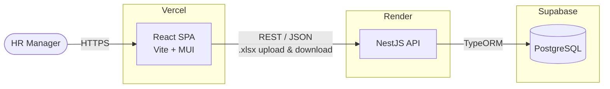
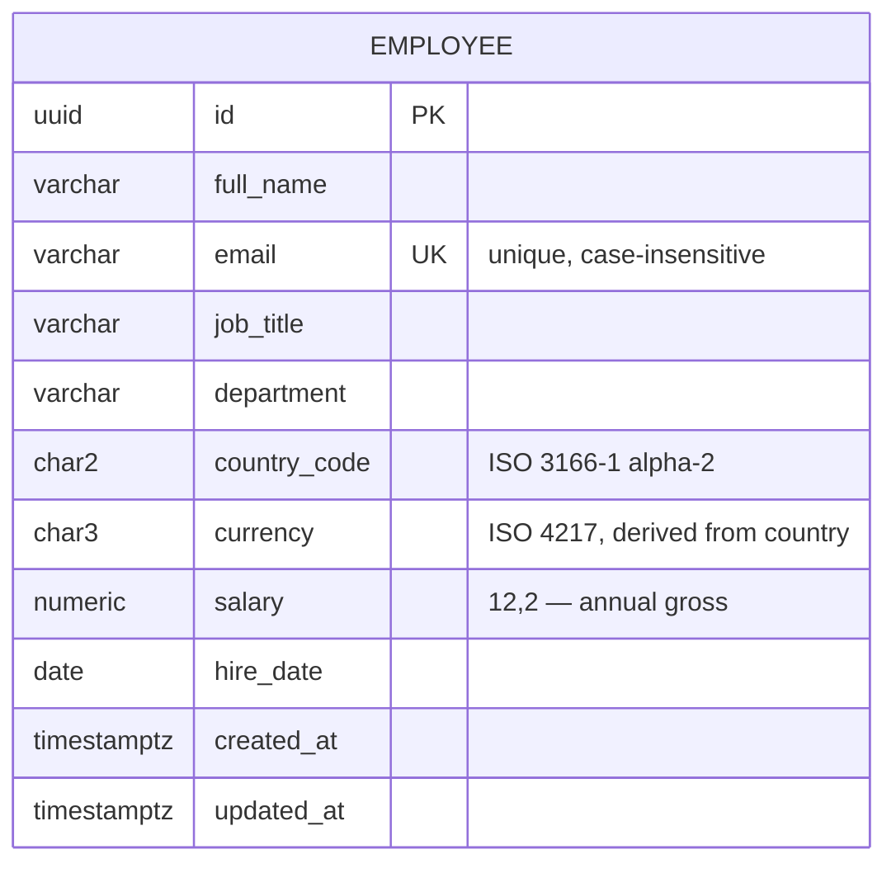
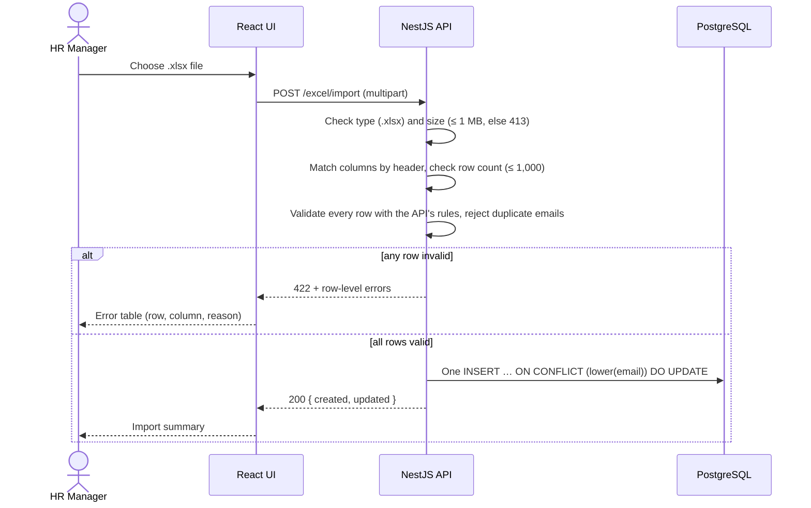

# Architecture

This document describes how the Salary Management system is structured and why. Decisions referenced as **ADR-n** are recorded in [decisions.md](decisions.md).

## System overview



Three deployable parts, each on a managed free tier:

| Part | Responsibility | Hosting |
|---|---|---|
| Frontend | Directory, employee forms, insights, import/export UI | Vercel |
| Backend | Validation, business rules, aggregation queries, Excel parsing/generation | Render |
| Database | Source of truth for employee and salary data | Supabase (PostgreSQL) |

## Repository layout

```
salary-management/
├── backend/            NestJS API
│   ├── src/
│   │   ├── employees/      CRUD, directory queries
│   │   ├── insights/       salary aggregations
│   │   ├── excel/          import (parse, validate, upsert) and export
│   │   ├── health/         liveness + database check
│   │   ├── common/         country/currency reference data, shared DTOs, pipes
│   │   └── database/       TypeORM config, migrations, seed script
│   └── test/               integration tests against a real Postgres
├── frontend/           React SPA
│   └── src/
│       ├── api/            typed API client
│       ├── features/       employees, insights, import-export
│       └── components/     shared UI
└── docs/               requirements, architecture, decisions, AI workflow
```

## Backend design

Each feature is a NestJS module with the same layering:

```
Controller  →  Service  →  Repository (TypeORM)
 HTTP, DTOs     business      persistence,
 validation     rules         SQL aggregates
```

- **Controllers** are thin: they map HTTP to DTOs and delegate. Validation uses `class-validator` DTOs with a global `ValidationPipe` (whitelisting on, unknown fields rejected).
- **Services** hold business rules (currency derivation, import validation, upsert decisions) and are unit tested with mocked repositories.
- **Repositories** own all query construction. Aggregations run in SQL, not in application memory (ADR-5).

### Data model



- A single table keeps the model honest for the scope: current salary only (salary history is out of scope — see requirements).
- `currency` is derived from `country_code` by the service, never accepted from the client, so the two cannot disagree.
- `salary` is `numeric(12,2)`: annual gross with up to 2 decimal places, stored exactly. It is mapped through a TypeORM transformer because Postgres returns `numeric` as a string. Binary floating point is never used to store or aggregate money (ADR-6).

**Indexes:** `country_code`, `department`, `(country_code, job_title)`, and a unique index on `lower(email)`.

### API

| Method | Path | Purpose |
|---|---|---|
| `GET` | `/employees` | Directory: `page`, `pageSize`, `search`, `country`, `department`, `jobTitle`, `sortBy`, `sortOrder` |
| `GET` | `/employees/:id` | Employee detail |
| `POST` | `/employees` | Create |
| `PATCH` | `/employees/:id` | Update |
| `DELETE` | `/employees/:id` | Delete |
| `GET` | `/employees/filter-options` | Distinct countries, departments, job titles for filter dropdowns |
| `GET` | `/insights/overview` | Total headcount; headcount by country and by department |
| `GET` | `/insights/countries` | Per country: headcount, min, max, average, median salary |
| `GET` | `/insights/countries/:code/job-titles` | Per job title in a country: headcount, average, min, max |
| `GET` | `/excel/template` | Blank import template (.xlsx) |
| `POST` | `/excel/import` | Upload .xlsx; all-or-nothing upsert by email |
| `GET` | `/excel/export` | Directory export (.xlsx), same filters as `/employees` |
| `GET` | `/health` | Liveness and database connectivity |

`GET /employees` returns `{ items, total, page, pageSize }`. `pageSize` defaults to 25 (maximum 100), sorting defaults to `fullName` ascending, and `sortBy` accepts only `fullName`, `salary` or `hireDate`. Search matches name or email case-insensitively; `%` and `_` in the search text match literally.

`GET /employees/filter-options` returns `{ countries, departments, jobTitles }`. Countries are the full reference list (`code`, `name`, `currency`), because the create form needs every country, not only those already in use; departments and job titles are the distinct values currently in the data.

Insight responses carry the currency with every figure, and salary figures are never combined across countries:

| Endpoint | Response |
|---|---|
| `GET /insights/overview` | `{ totalHeadcount, byCountry: [{ countryCode, countryName, currency, headcount }], byDepartment: [{ department, headcount }] }`, largest first |
| `GET /insights/countries` | `[{ countryCode, countryName, currency, headcount, minSalary, maxSalary, averageSalary, medianSalary }]` |
| `GET /insights/countries/:code/job-titles` | `{ countryCode, countryName, currency, jobTitles: [{ jobTitle, headcount, minSalary, maxSalary, averageSalary }] }`, highest average first; unknown country codes return `400` |

Averages and medians are rounded to cents in SQL. `percentile_cont` computes in double precision, which is exact for the two-decimal amounts in range here; the result is cast back to `numeric` before rounding.

Errors follow one shape: `{ statusCode, message, errors? }`. Import validation failures return `422` with row-level `errors: [{ row, column, message }]`.

### Excel import flow



Validation runs over the whole file before any write, and all rows are then written by a single multi-row upsert. A single statement is atomic, so a file is either fully applied or not at all (ADR-7), and even a full 1,000-row file costs one database round trip. Created and updated rows are told apart in the same statement (`RETURNING (xmax = 0)`). The 1,000-row limit keeps imports to a few seconds on a small instance; the initial 10,000 employees are loaded by the seed script, not by import.

**Import rules in detail**
- Columns are matched by header name, ignoring letter case, spacing and order; unknown columns are ignored. Missing required columns are reported against row 1.
- Every row is validated with the same rules as `POST /employees`. Emails are compared case-insensitively, and an email that appears twice in one file is an error, because it is ambiguous which row should win.
- Excel cell types are normalised: hyperlinked emails, rich text and formula results are read as their values, date cells become `YYYY-MM-DD`, and salaries typed as text (`85,000.50`) are accepted.
- Responses: `200 { created, updated }`; `422 { statusCode, message, errors: [{ row, column, message }] }` for invalid rows; `400` for a missing, non-.xlsx, unreadable, empty or over-limit file; `413` for files over 1 MB. Re-importing the same file is idempotent.

**Template and export.** The template (`/excel/template`) has the import headers, a country-code dropdown and an Instructions sheet listing the rules and country codes. The export (`/excel/export`) accepts the directory's search, filters and sort (without paging) and uses the template's columns plus `Currency`, which import ignores, so HR can export, edit and import the same file back.

## Frontend design

- **Feature folders** (`employees`, `insights`, `import-export`) each own their pages, components and hooks.
- **Server state** via TanStack Query: caching, loading and error states, and cache invalidation after create/update/delete/import.
- **Directory** uses MUI DataGrid in server mode: paging, sorting and filtering are sent to the API, so the browser never holds 10,000 rows.
- **Typed API client** in `src/api` is the only place that knows URLs.

### Responsive layout

The UI is built mobile-first with MUI breakpoints, and verified at three reference widths: **360 px** (phone), **768 px** (tablet) and **1280 px** (desktop).

| Area | Phone (`xs`) | Tablet (`sm`–`md`) | Desktop (`lg`+) |
|---|---|---|---|
| Navigation | Top bar with a slide-out drawer | Top bar with a slide-out drawer | Top bar with section tabs |
| Employee directory | Card list (name, title, country, salary); further pages appended with a "Show more" button | Data grid with essential columns only | Full data grid |
| Filters | Collapsible filter panel, with a sort menu in place of column headers | Inline filter row | Inline filter row |
| Employee form | Single column, full-screen dialog | Two columns | Two columns in a dialog |
| Insights | Stacked summary cards; tables scroll horizontally | Two-column grid | Multi-column grid |
| Import errors | Scrollable error list | Table | Table |

Touch targets are at least 44 × 44 px, and nothing depends on hover to be discoverable.

## Performance considerations

| Concern | Approach |
|---|---|
| Listing 10,000 employees | Server-side pagination (default 25, max 100 per page); count and page fetched in one request |
| Filtering and sorting | Indexed columns; sort fields whitelisted to prevent arbitrary SQL |
| Search | `ILIKE` on name and email. At 10,000 rows a scan is a few ms; a `pg_trgm` index is the next step if data grows ~10× |
| Insights | Single `GROUP BY` queries in Postgres; median via `percentile_cont(0.5)` |
| Import | Capped at 1,000 rows; validate in memory, then one multi-row upsert statement. Measured: a 1,000-row file imports in about 1.8 s end to end, including a 300 ms round trip from a laptop |
| Export | Rows are written to the response as the workbook is generated, so the file is never assembled in memory first. Measured: all 10,000 employees export in about 3 s |
| Seeding | One transaction of 1,000-row batched inserts; 10,000 rows in about 12 s even over a 300 ms round trip from a laptop |
| Measured query time | At 10,000 employees, Postgres executes the country summary in ~14 ms, a job-title breakdown in ~2 ms, a filtered directory page in under 1 ms and a name/email search in ~23 ms. End-to-end latency is dominated by the network round trip between API and database. |
| Deployed response time | API on Render and database on Supabase, both in Singapore. Median per request, measured from a client in India (~45 ms away): health 127 ms, directory page 131–134 ms, search 185 ms, filter options 138 ms, insights 126–134 ms, all within the 300 ms target. With the database in Sydney the same requests took 298–369 ms, which is why API and database are co-located (ADR-10). |

## Testing strategy

| Level | Scope | Tooling |
|---|---|---|
| Unit (backend) | Services, validators, import row parser, currency mapping, query building | Jest, mocked repositories — no network, no database |
| Unit (frontend) | Key components and hooks | Vitest + React Testing Library |
| Integration (backend) | The SQL itself: insight aggregates and median rounding, directory filters, search escaping and stable paging, the import upsert, and the database's unique and check constraints | Jest against a real PostgreSQL database whose name ends in `_test`; the schema is rebuilt from the migrations on every run. CI provides a throwaway Postgres 16 service |

Tests are deterministic: no reliance on wall-clock time, random data uses fixed seeds, and each test arranges its own data.

Unit tests (`npm test`) never touch a database, so they run anywhere in seconds. Integration tests (`npm run test:integration -w backend`) live in `backend/test/` and need `TEST_DATABASE_URL`; they refuse to run against a database whose name does not end in `_test`, because every test empties the employees table.
